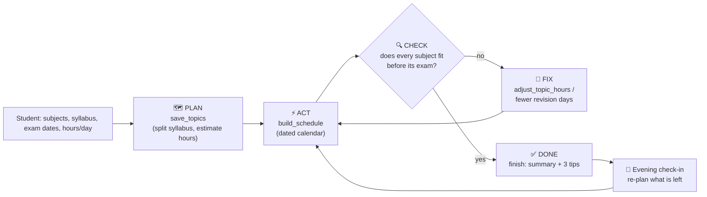
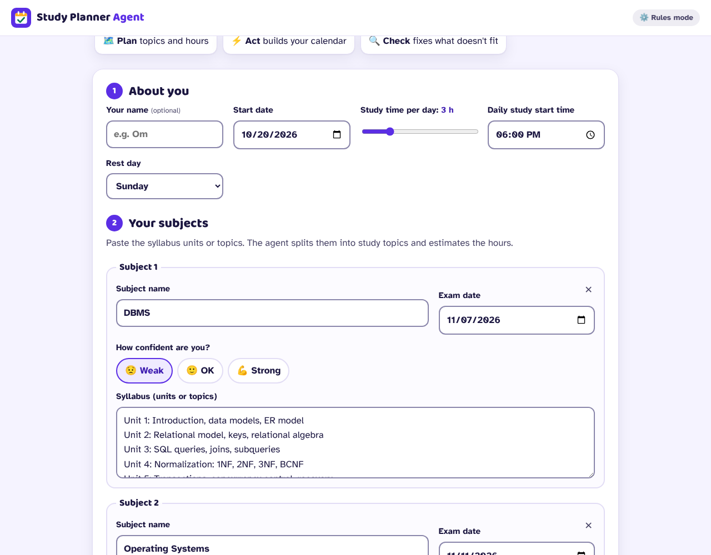
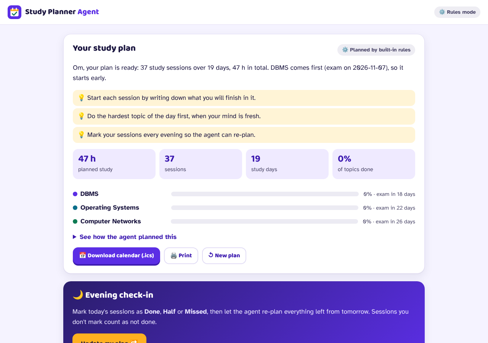
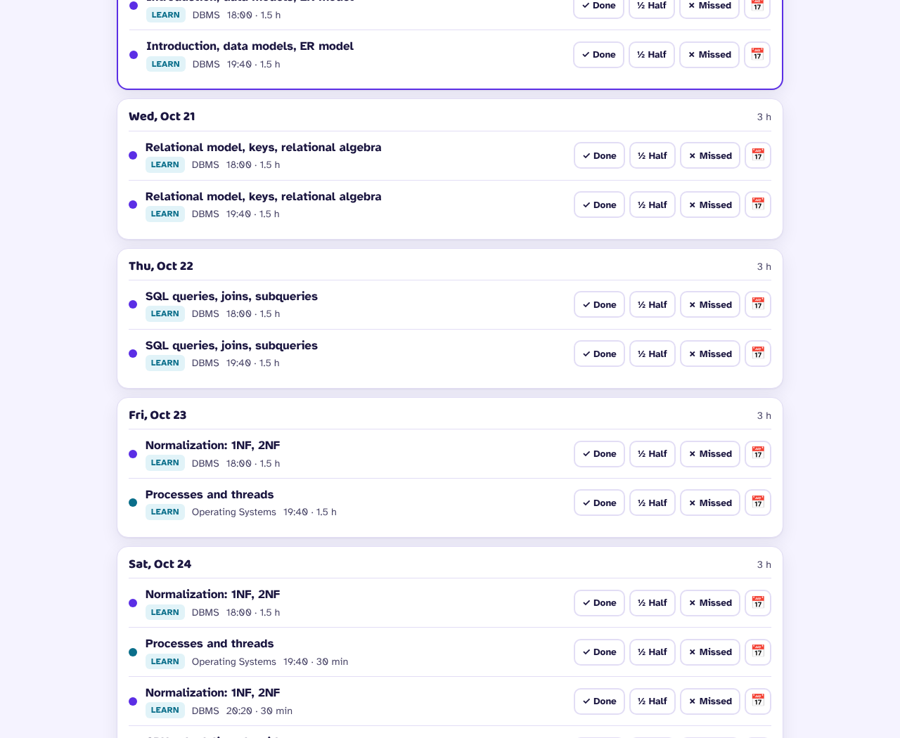
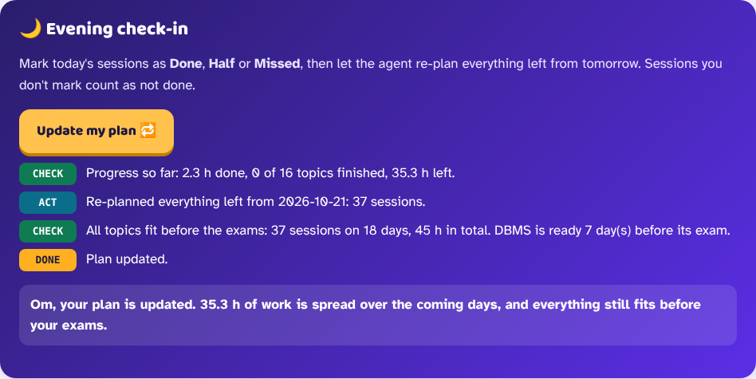
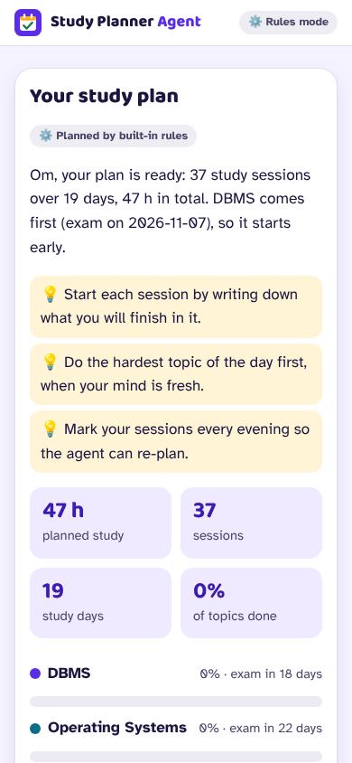

# 📅 AI Study Planner Agent

[](https://github.com/omshiva24/ai-study-planner-agent/actions/workflows/ci.yml)   [](LICENSE)

**Your exams in. A day-by-day study plan out — and it re-plans every evening.**

Type your subjects, paste the syllabus and pick the exam dates. An AI agent (Google Gemini with function calling) splits each syllabus into topics, estimates the hours, builds your calendar, **checks that everything fits before every exam**, fixes what doesn't, and explains its plan. Every evening you mark what you finished, and the agent re-plans everything that is left.

**Live app:** _(link added after the first deploy)_
**Created by:** **P Om Shiva**, M.Tech CSE (2nd year), Pondicherry University · [GitHub @omshiva24](https://github.com/omshiva24)
**© 2026 P Om Shiva. All rights reserved.** See [LICENSE](LICENSE).

---

## What makes it an *agent* (not just a chatbot)

A chatbot answers once. An agent **plans, acts with tools, checks the result and fixes it** in a loop. This app shows every step live on screen:



| Tool (Gemini function call) | Step | What it does |
|---|---|---|
| `save_topics` | PLAN | Splits every syllabus into topics in order, with study hours (more for weak subjects, less for strong ones) |
| `build_schedule` | ACT | Turns topics into dated sessions with revision days and a mock test before each exam |
| *(automatic)* | CHECK | The scheduler's report (what fits, what doesn't, by how much) is sent back to Gemini |
| `adjust_topic_hours` | FIX | Gemini trims lower-priority topics or changes the strategy, then builds again |
| `finish` | DONE | A short, friendly summary and three practical tips for this plan |

**The AI decides *what* to study and *how*; plain code does the calendar maths**, so dates, daily hours and rest days are always correct. If Gemini is busy or no key is set, the same loop runs with built-in rules, so the app always gives a plan.

## Features

| | Feature | Details |
|---|---|---|
| 🧠 | **Gemini agent** | Function calling in a PLAN → ACT → CHECK → FIX loop, with every step shown live |
| 📚 | **Any syllabus** | Paste units, bullet lists, numbered lists or semicolon lists; up to 8 subjects |
| 😟💪 | **Confidence per subject** | Weak subjects get more hours and an earlier, faster pace |
| ⚖️ | **Balanced daily mix** | Subjects are mixed day by day; when time gets tight, the most urgent subject goes first |
| 🔁 | **Revision + mock test** | Revision days and a mock test before every exam |
| 🌙 | **Evening check-in** | Mark sessions Done / Half / Missed; the agent re-plans from tomorrow and tells you what changed |
| 📅 | **Calendar export** | Download an `.ics` file (Google Calendar, Outlook, Apple) or add any session to Google Calendar in one tap |
| 📊 | **Progress** | Per-subject progress bars, days to each exam, % of topics done |
| 🖨️ | **Print** | A clean printable plan |
| 🔒 | **Private** | No login, no database: your plan stays in your browser |

## Screenshots







 

## Tech

- **AI:** Google Gemini (REST API, function calling, `thinkingLevel: LOW` on Gemini 3 models), with automatic fallback to other Flash models when one is busy or out of free quota
- **Backend:** Node.js serverless functions on Vercel (`api/plan.js`, `api/replan.js`, `api/status.js`) — **zero npm dependencies**, built-in `fetch` and `http`
- **Frontend:** plain HTML, CSS and JavaScript (no framework), Baloo 2 + Atkinson Hyperlegible fonts
- **Tests:** 20 tests with Node's built-in test runner, including a 300-case fuzz test of the scheduler; run on every push in GitHub Actions

## Project structure

```
api/                  Vercel functions: plan, replan, status
src/
  http.js             security headers, body limits, rate limit, error handling
  services/
    plannerAgent.js   the agent loop: tools, PLAN → ACT → CHECK → FIX → DONE
    geminiRest.js     Gemini REST client (function calling, model fallback)
  utils/
    scheduler.js      dated calendar + the CHECK report + shrink-to-fit
    topics.js         syllabus splitting and topic cleaning
    validation.js     server-side input validation
    dates.js          time-zone-safe date maths
public/               index.html, styles.css, app.js, fonts
tests/                node:test suites
scripts/dev-server.js local dev server (same handlers as Vercel)
```

## Run locally

Requires Node.js 20+ and (optionally) a free Gemini API key from [Google AI Studio](https://aistudio.google.com). Without a key the agent uses its built-in rules.

```bash
cp .env.example .env      # put your GEMINI_API_KEY in .env
npm start                 # http://localhost:8080
npm test                  # 20 tests, no install needed
```

| Setting | Default | Purpose |
|---|---|---|
| `GEMINI_API_KEY` | (empty = rules only) | Your key; server only |
| `GEMINI_MODEL` | `gemini-3.8-flash` | Use `gemini-3.5-flash-lite` for faster, cheaper plans |
| `AI_TIMEOUT_MS` | `20000` | Time limit for one AI call |
| `AGENT_BUDGET_MS` | `45000` | Time limit for the whole agent loop |
| `RATE_LIMIT_MAX` | `8` | Plans per minute per visitor |

## Deploy to Vercel

1. Import this repository in Vercel (no build settings needed).
2. In **Settings → Environment Variables**, add `GEMINI_API_KEY` (mark it **Sensitive**) and optionally `GEMINI_MODEL`.
3. Redeploy.

## Security

API key only on the server, strict server-side validation, prompt-injection defence, clamped tool arguments, strict CSP and security headers, `textContent`-only rendering, rate limiting, and no stored personal data. Details in [SECURITY.md](SECURITY.md).

## Author

**P Om Shiva** · M.Tech CSE (2nd year), Pondicherry University · [github.com/omshiva24](https://github.com/omshiva24) · YouTube: [TechVibe24](https://youtube.com/@techvibe24)

AI Study Planner Agent was designed and built by P Om Shiva. **© 2026 P Om Shiva. All rights reserved.** No part of this project may be copied, reused, modified or redistributed without the author's written permission. See [LICENSE](LICENSE).
